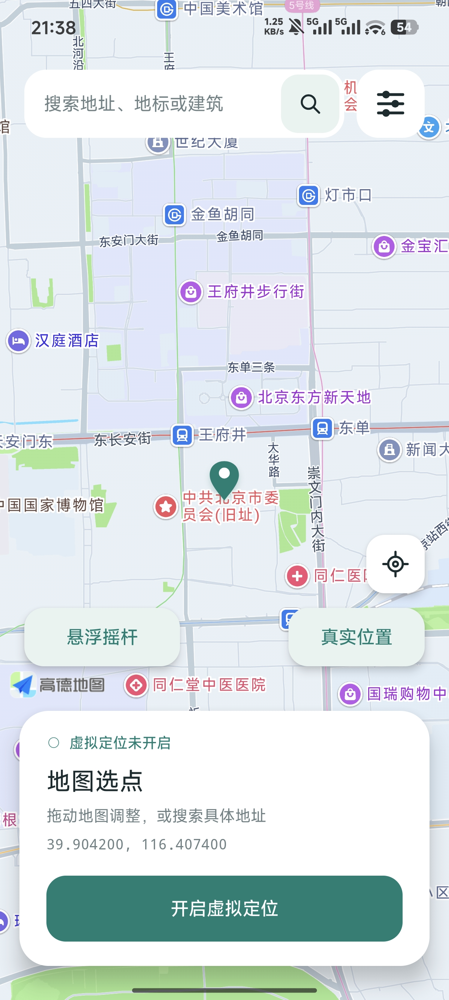

# FakeGeo

FakeGeo 是一款免费开源的 Android 虚拟定位工具，面向已 Root、安装 LSPosed 的 Android 10 及以上设备。通过系统服务 Hook 修改定位及相关无线信息，使用高德地图选点和地址搜索。

## 功能介绍

- 地图拖动选点、地址搜索，一键开启或停止虚拟定位。
- 将地图准星移到当前真实 GPS 位置，确认后再手动应用。
- 悬浮摇杆控制方向，支持走路、跑步、骑车及速度调整。
- 定位漂移、Wi-Fi、蓝牙和基站信息等高级参数设置。
- 选择应用，手动清除支持的高德／百度定位缓存，并恢复最近备份。
- 首次使用引导、Root 授权、系统 Hook 状态检测和 GitHub 更新检查。

部分 App 不生效，发现问题请提交 [Issue](https://github.com/myxuebi/FakeGeo/issues)。

## 软件截图

## 使用说明

### 首次配置

1. 在已 Root 的设备安装 FakeGeo，阅读并同意首次声明，按引导完成配置。
2. 点击请求 Root 授权，在 KernelSU 或其他 Root 管理器中允许 FakeGeo。
3. 在 LSPosed 启用模块，勾选 Android 系统／系统框架、电话服务、蓝牙，以及设备提供的独立 Wi-Fi 服务作用域，然后重启手机。
4. 在高级设置的“高德地图与搜索设置”填写自己的 **高德 Android SDK Key**。绑定包名 `io.github.fakegeo` 和该页面显示的当前签名 SHA1，同意高德服务后保存。
5. 保持系统定位开启，检测系统 Hook 状态，确认已加载并同步。

### 地图定位

在首页搜索地址并选择结果，或拖动地图将准星移到目标地点，点击“开启虚拟定位”。修改选点后点击“应用新位置”；点击停止按钮结束虚拟定位。

“真实位置”需要精确定位权限和可用的 GPS 信号，只调整准星，不自动改变已发布的虚拟位置。GPS 无信号时请到开阔位置重试。

### 悬浮移动

先开启虚拟定位，再点击“悬浮摇杆”，授权显示悬浮窗并打开摇杆。选择走路、跑步或骑车，调整速度，推动摇杆控制方向：上北、下南、左西、右东，推得越远越快。

松手、暂停或关闭控制窗停止移动；关闭控制窗保留虚拟定位开关，需要结束定位时返回首页点击停止。部分 App 可能显示位置变化但不计入运动距离。

### 高级设置

定位精度、更新间隔、漂移半径，以及 Wi-Fi、蓝牙、基站等参数在高级设置调整，保存并应用后生效。

若应用使用旧的定位缓存，可选择该应用并点击“清除所选应用的定位缓存”。清理会关闭所选应用，保留可恢复备份，仅处理支持的定位缓存文件；没有匹配文件时不清空应用数据。恢复最近备份前需停止虚拟定位。

高级设置底部可查看关于、使用声明和首次引导，点击“检查更新”获取 GitHub 最新正式 Release。地图与地址搜索需要网络和有效的高德 Key。
